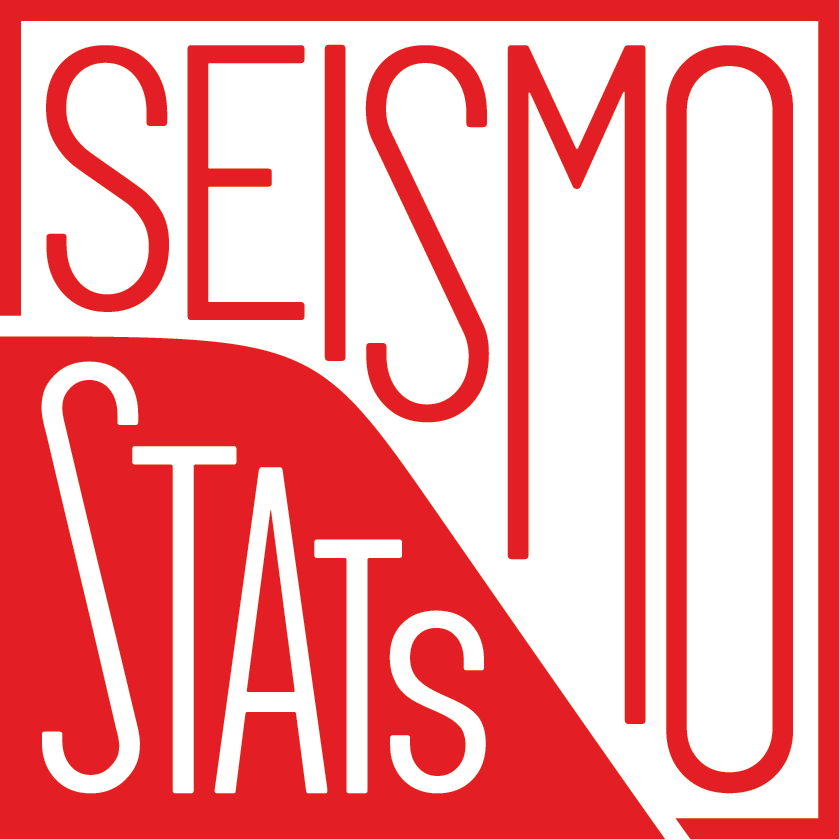

<h1 align="center">



<hr \>


[](https://pypi.org/project/seismostats/)
[](https://pypi.org/project/seismostats/)
[](https://github.com/swiss-seismological-service/SeismoStats/actions/workflows/tests.yml)
[](https://codecov.io/github/swiss-seismological-service/SeismoStats)
[](https://seismostats.readthedocs.io/latest/)

</h1>

<p align="center">
  <a href="README.md">English</a> | 简体中文
</p>

使用 **SeismoStats** 量化分析您的地震活动性——这是一个专为地震活动性分析打造的 Python 工具包。完整文档请参阅：https://seismostats.readthedocs.io/latest/ 。

>[!IMPORTANT]  
> 我们诚挚欢迎来自社区的贡献！如果您有任何想法、发现了 Bug，或希望进一步完善本工具包，请提交 Issue 或发起 Pull Request：<br>
> https://github.com/swiss-seismological-service/SeismoStats/issues <br>
> 开始之前，请参阅 [贡献指南（Contributing Guidelines）](CONTRIBUTING.md)。<br>
> 我们鼓励每一位用户参与进来，共同完善 SeismoStats！

## 开始使用 `SeismoStats`：

本节面向希望直接使用 `SeismoStats` 现有功能与函数的用户——例如，为您研究的地震目录计算完备震级 $M_c$、$a$ 值和 $b$ 值，并绘制震级-频度分布图。

```bash
pip install seismostats
```

就是这么简单，您现在即可开始使用 SeismoStats！

## 从源码安装

如需获取 SeismoStats 的最新版本，您可以直接从源码安装。如果您计划参与 SeismoStats 的开发与贡献，此方式尤为适用。

克隆仓库后，在仓库根目录下运行以下命令即可安装 SeismoStats：
```bash
pip install .
```
或以开发模式安装（包含开发依赖）：
```bash
pip install -e '.[dev]'
```
运行测试：
```bash
tox
```

## 引用
我们正在积极撰写一篇随 `SeismoStats` 首个稳定版本一同投稿的学术论文。如果您在科研工作中使用了本代码，在预印本发布之前，请按以下方式引用 `SeismoStats`：

Mirwald, A., Schmid, N., Mizrahi L., Han, M., Rohnacher, A., Ritz, V. A., & Wiemer, S. (2025). SeismoStats: A Python Package for Statistical Seismology (https://doi.org/10.48550/arXiv.2511.04521).
```bibtex
@misc{Mirwald2025,
   author = {Aron Mirwald and Nicolas Schmid and Leila Mizrahi and Marta Han and Alicia Rohnacher and Vanille A. Ritz and Stefan Wiemer},
   title = {SeismoStats: A Python Package for Statistical Seismology},
   url = {https://github.com/swiss-seismological-service/SeismoStats},
   year = {2025}
}

```

引用元数据亦可通过本仓库中的 [CITATION.cff](CITATION.cff) 文件获取。
